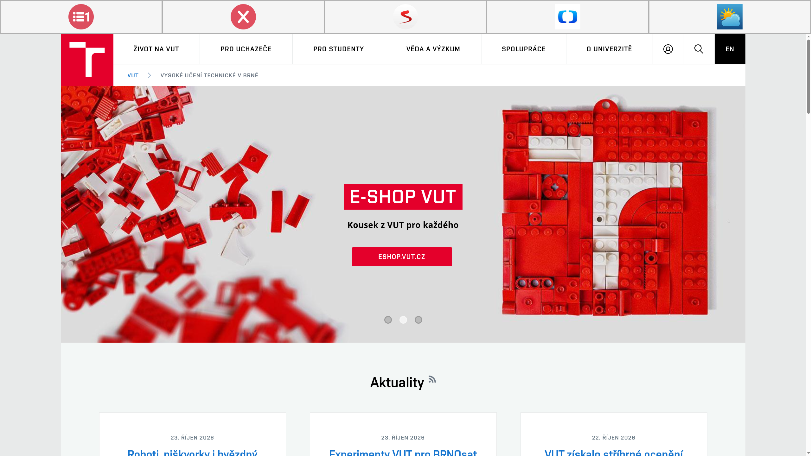
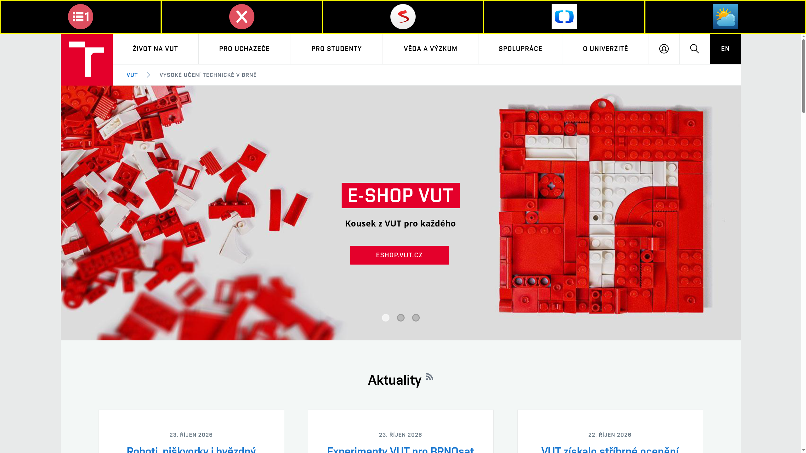

# Sweb - Webový prohlížeč pro seniory

[](https://github.com/Ad4mCZ/sweb/blob/main/README.md)

**Sweb** je modulární a přístupný webový prohlížeč navržený speciálně pro seniory. Aplikace byla vyvinuta jako součást diplomové práce na Fakultě elektrotechniky a komunikačních technologií Vysokého učení technického v Brně (FEKT VUT) s využitím Pythonu, PyQt6 a QtWebEngine. Prohlížeč se zaměřuje na odstranění běžných frustrací, kterým starší dospělí čelí při procházení moderního webu, a to poskytnutím jednoduchého a bezpečného prostředí bez rušivých elementů.

## 🌟 Hlavní funkce
* **Zjednodušené rozhraní:** Velká, jasně označená tlačítka a intuitivní navigační lišta přizpůsobená pro sníženou motorickou přesnost.
* **Kioskový režim (Kiosk Mode):** Spuštění v režimu celé obrazovky bez rámečku zabraňuje nechtěnému minimalizování, změně velikosti nebo ukončení aplikace.
* **Integrovaný AdBlock:** Automatický síťový filtr, který blokuje reklamy a sledovací skripty, čímž zajišťuje čistý zážitek ze čtení a předchází pádům vykreslovacího jádra na náročných stránkách.
* **Modulární architektura:** Rozšiřitelný systém doplňků (`module_manager`) pro snadnou integraci funkcí na pozadí (jako AdBlock) a rozšíření uživatelského rozhraní (jako připravovaná Lupa).
* **Multiplatformní stabilita:** Upravená konfigurace jádra Chromium pro zajištění plynulého chodu napříč prostředími, od Linuxu po macOS.

## ⚙️ Konfigurační soubory
Prohlížeč je plně přizpůsobitelný pomocí JSON souborů, což udržuje uživatelská data a preference oddělené od zdrojového kódu. Tyto soubory jsou bezpečně uloženy v konfigurační složce aplikace specifické pro daný operační systém (Linux: `~/.config/vut/sweb` a `~/.local/share/vut/sweb`; macOS: `~/Library/Application Support/vut/sweb` a `~/Library/Preferences/vut/sweb`):

* `config.json` - Spravuje obecná nastavení prohlížeče, stavy uživatelského rozhraní a konfigurace motivů.
* `bookmarks.json` - Ukládá předdefinované oblíbené webové stránky (např. Seznam, ČT24, Počasí) zobrazené přímo na hlavní obrazovce.
* `adblock.json` - Obsahuje snadno udržovatelný a rozšiřitelný seznam blokovaných reklamních a sledovacích domén.

### Možnosti nastavení v `config.json`

| Klíč | Výchozí hodnota | Popis |
|------|-----------------|-------|
| `ui_font_size` | `24` | Velikost písma (v `px`) popisků tlačítek v navigační liště. |
| `web_zoom_factor` | `1.5` | Měřítko přiblížení webových stránek (`1.0` = 100 %, `1.5` = 150 %). |
| `color_theme` | `"default"` | Barevné schéma navigační lišty: `"default"` nebo `"high_contrast"`. |
| `home_url` | `"https://www.seznam.cz"` | Výchozí domovská stránka načtená po spuštění prohlížeče. |
| `search_url` | `"https://search.seznam.cz/?q={}"` | Šablona URL vyhledávače (`{}` se nahradí hledaným výrazem). |
| `search_button_position` | `"after"` | Pozice tlačítka **Hledat** v Menu 2 vůči záložkám: `"before"` (před) nebo `"after"` (za). |

Příklad `config.json`:
```json
{
    "ui_font_size": 24,
    "web_zoom_factor": 1.5,
    "color_theme": "default",
    "home_url": "https://www.seznam.cz",
    "search_url": "https://search.seznam.cz/?q={}",
    "search_button_position": "after"
}
```

Příklad `bookmarks.json`:
```json
{
    "first_menu": [
        {
            "name": "Seznam",
            "url": "https://www.seznam.cz"
        },
        {
            "name": "ČT24",
            "url": "https://ct24.ceskatelevize.cz"
        },
        {
            "name": "Počasí",
            "url": "https://www.in-pocasi.cz"
        }
    ],
    "second_menu": [
        {
            "name": "Deník",
            "url": "https://www.denik.cz"
        },
        {
            "name": "Novinky",
            "url": "https://www.novinky.cz"
        },
        {
            "name": "Lékárna",
            "url": "https://www.lekarna.cz"
        }
    ]
}
```

Příklad `adblock.json`:
```json
{
    "blocked_domains": [
        "doubleclick.net",
        "googlesyndication.com",
        "google-analytics.com",
        "googletagmanager.com",
        "clarity.ms",
        "facebook.com/tr",
        "imrworldwide.com",
        "chartbeat.net",
        "imedia.cz",
        "criteo.com",
        "adform.net"
    ]
}
```

## 🎨 Vizuální režimy
Sweb nabízí různé vizuální motivy, aby vyhověl různým zrakovým potřebám. Níže uvedené animace demonstrují výchozí zobrazení rozhraní, stejně jako zřetelnou vizuální odezvu poskytovanou při **najetí myší (hover)** a **kliknutí (click)**.

### Výchozí barevné schéma
*(Standardní, klidný vizuální motiv navržený pro každodenní použití.)*  


### Vysoký kontrast
*(Speciální režim maximalizující viditelnost textu a prvků pro uživatele se zrakovým postižením.)*  


## 📄 Licence a poděkování
Tento projekt je licencován pod **GNU General Public License v3.0 (GPL-3.0-or-later)** — podrobnosti naleznete v souboru [LICENSE](LICENSE).

* **PyQt6 & PyQt6-WebEngine:** Licencováno pod GNU GPL v3 (Riverbank Computing Limited).
* **Qt 6 & Qt WebEngine:** Licencováno pod GNU LGPL v3 / GPL v3 (The Qt Company).
* **Chromium:** Licencováno pod 3-Clause BSD licencí a příslušnými open-source licencemi dílčích knihoven.
* **Ikony:** Navigační ikony ve složce `sweb/icons/` vytvořil [Roundicons - Flaticon](https://www.flaticon.com).

