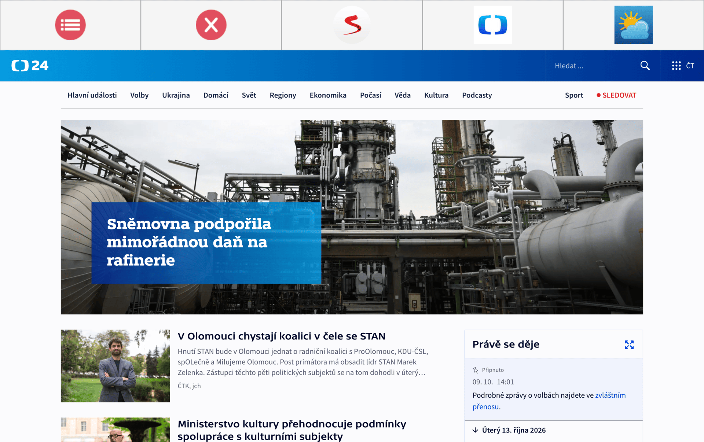
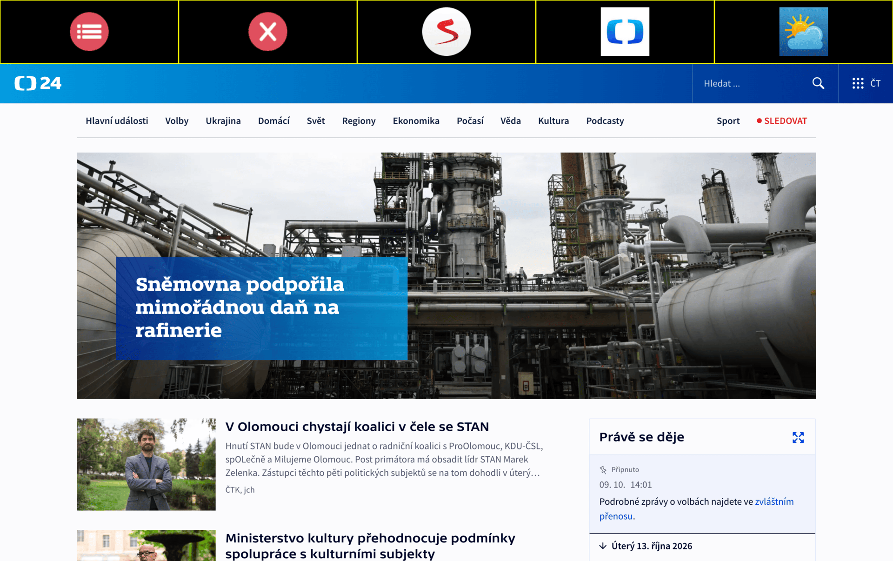

# Sweb - Senior-Friendly Web Browser

**Sweb** is a modular and accessible web browser designed specifically for seniors. Developed as part of a diploma thesis at the Faculty of Electrical Engineering and Communication, Brno University of Technology, the application is built with Python, PyQt6, and QtWebEngine. The browser focuses on eliminating common frustrations older adults face when navigating the modern web by providing a distraction-free, simplified, and safe environment.

## 🌟 Key Features
* **Simplified Interface:** Large, clearly labeled buttons and an intuitive navigation bar tailored for reduced motor precision.
* **Kiosk Mode:** Fullscreen, frameless window execution prevents accidental application minimization, resizing, or exits.
* **Built-in AdBlock:** An automatic network-level interceptor that blocks ads and tracking scripts, ensuring a clean reading experience and preventing core render crashes on heavy sites.
* **Modular Architecture:** An extensible plugin system (`module_manager`) for easily integrating background features (like AdBlock) and UI extensions (like Magnifier (TBA)).
* **Cross-Platform Stability:** Hardened Chromium engine configurations to ensure smooth performance across environments, from Linux to macOS.

## ⚙️ Configuration Files
The browser is fully customizable via JSON files, keeping user data and preferences separated from the source code. These files are securely stored in the OS-specific application configuration directory (Linux ~/.config/vut/sweb and ~/.local/share/vut/sweb; macOS 
 ~/Library/Application Support/vut/sweb and ~/Library/Preferences/vut/sweb):

* `config.json` - Manages general browser settings, UI states, and theme configurations.
* `bookmarks.json` - Stores pre-defined favorite websites (e.g., Seznam, ČT24, Počasí) displayed directly on the main screen.
* `adblock.json` - Contains a maintainable, easily extensible list of blocked advertising and tracking domains.

## 🎨 Visual Modes
Sweb provides different visual themes to accommodate varying visual needs. The animations below demonstrate the default interface view, as well as the distinct visual feedback provided during **hover** and **click** interactions.

### Default Color Scheme
*(The standard, calm visual theme designed for everyday use.)*  

### High Contrast
*(A specialized mode maximizing text and element visibility for users with visual impairments.)*  

